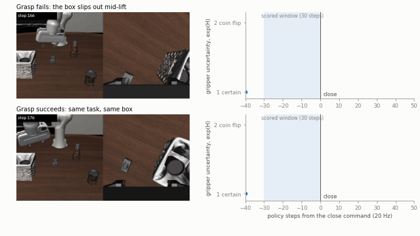
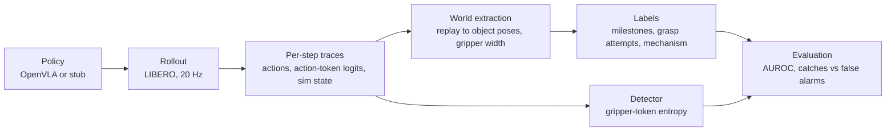

# libero-eval-harness-workspace

Can a robot policy's own uncertainty warn that a grasp is about to fail? This project tests that
for OpenVLA, a vision-language-action model, on LIBERO-Long, a benchmark of multi-step household
manipulation tasks in simulation.

**Gripper-token entropy did not reliably predict grasp failure.** Frozen on 250 episodes and
tested once on 250 held-out episodes, it scored a failed grasp attempt above a successful one 56%
of the time (95% CI 49% to 63%, AUROC; 110 failed and 237 successful first attempts), short of the
pre-registered bar. The signal it does carry is a few uncertain steps where the near-binary
gripper token flips, and those look the same before failures and successes.

The pass criterion was set before testing, and the held-out episodes were used once, so the result
could not be adjusted after the fact.



*Same task, same box: a grasp that fails (top) and one that succeeds (bottom), aligned on the
close command, at half speed. The detector scores the 30 steps before the close. Both spike to near
a coin flip inside that window, and both raise the alarm. In the failure, the trace stays at
"certain" while the box slips out.*

## What's here

- **A reproduced baseline.** `openvla/openvla-7b-finetuned-libero-10`, used as released with no
  further fine-tuning, succeeds on 130 of 250 episodes (52.0%, 95% CI 45.8% to 58.1%), in line
  with the 53.7 ± 1.3% the OpenVLA paper reports.
- **A failure taxonomy.** Each of the 120 failures is coded by how far the task got and what went
  wrong first, by hand or by a rule-based classifier over simulator state that agrees with held-out
  hand labels on 20 of 29 decided cases.
- **A pre-registered detector test.** The detector and its pass criterion were frozen before the
  held-out run; the result is recomputable from committed files with one command, no GPU needed.

## Results

### Failure prediction

At each first close command on a goal object, the primary detector (v1) averages the gripper
token's exp(entropy) over the preceding 30 policy steps and alarms above the level that 20% of
successful development attempts exceed. Its inputs are policy outputs only; labels come from
simulator state. Pre-registered pass: the AUROC CI excludes 0.5 and the excess-over-chance CI
(catch rate minus false-alarm rate) excludes 0.

| | AUROC | caught | false alarms | excess over chance | pass |
|---|---|---|---|---|---|
| v1 (primary), development, in-sample | 0.62 | 28 of 88 | 53 of 266 (20%) | 0.12 | n/a |
| **v1 (primary), held-out** | **0.56 (0.49 to 0.63)** | 32 of 110 | 42 of 237 (18%) | 0.11 (0.02 to 0.21) | **no** |
| v2 (secondary), held-out | 0.57 (0.50 to 0.64) | 34 of 110 | 44 of 237 (19%) | 0.12 (0.03 to 0.22) | marginal |

Development: init states 0–24; held-out: init states 25–49, evaluated once with no refit. 95% CIs
bootstrap over episodes within (task, episode outcome). v2 adds roll-dimension entropy; its AUROC
lower bound is 0.501, so `detector_eval.json` marks it as passing, but the verdict rests on the
pre-registered primary.

- **The gripper action is effectively binary.** Its probability sits on two tokens, so exp(H) lies
  in [1, 2]. Half of all attempts never leave 1: no step in the window is uncertain.
- **Alarms come from 1–5 uncertain steps at the switch,** nearly all within 12 steps of the close
  command. On 15 reviewed videos, caught failures and false alarms look the same, and the signal
  does not follow the failure mechanism.

Full writeup: `docs/block4_findings.md`. Results: `docs/results/heldout/block4/`.

### Baseline

130/250 = 52.0% success (Wilson 95% interval 45.8–58.1%), 10 tasks × 25 init states, seed 0; the
OpenVLA paper reports 53.7 ± 1.3% for this checkpoint. Details: `docs/results/baseline/`,
`docs/block1_findings.md`.

### Failure taxonomy

Every one of the 120 failures carries a milestone (subgoals completed, `k`, computed from replayed
simulator state) and a mechanism (the earliest error never recovered from). Rules:
`docs/labeling_protocol.md`. Per-episode table:
`docs/results/baseline/labeling/failure_mechanisms.csv`.

| Mechanism | Failures | Hand-labeled | Classifier |
|---|---|---|---|
| `control: grasp` | 41 | 14 | 27 |
| `perception` | 38 | 22 | 16 |
| `control: place` | 22 | 12 | 10 |
| `control: transport` | 11 | 5 | 6 |
| `inaction` | 7 | 2 | 5 |
| no identifiable onset | 1 | 1 | 0 |

`grounding` and `external`: 0. Milestones: `k` = 0 for 52 failures, 1 for 60, 2 for 8.
`perception` means the arm was off target at the grasp.

**Classifier agreement.** A rule-based classifier over world state (no model outputs) labels the
64 failures without a hand label. Thirty held-out episodes were hand-labeled blind to it, then the
classifier was frozen and scored once: **agreement 20/29 decided (69%), 1/30 abstained**; onsets
within ±10 steps for 18/29. On the 20 development labels it agrees 20/20, optimistic by
construction. Four rules were revised after held-out labeling exposed them, so agreement on those
four episodes is not independent.

<details>
<summary>The 9 held-out cases that did not agree</summary>

Every disagreement sits on the boundary between neighbouring stages: aiming versus closing at the
grasp, or carrying versus placing.

| Hand label → classifier | n | Episodes | What happened |
|---|---|---|---|
| `perception` → `control: grasp` | 4 | t00-i003, t00-i010, t02-i006, t08-i001 | Two closed with high finger-pad cover on the object (0.67, 0.79), read as on target; in two the predicted onset is 19 and 42 steps later than the hand onset |
| `control: place` → `control: transport` | 3 | t04-i000, t04-i008, t05-i011 | The object shifted in the hand while carried; the classifier counts that as the first error |
| `control: transport` → `control: grasp` | 1 | t01-i024 | Onset placed at the grasp, 55 steps earlier |
| `control: grasp` → `perception` | 1 | t04-i019 | Low pad cover (0.16) at the close |
| `control: place` → abstain | 1 | t05-i019 | No unrecovered error found |

`control: place` is the weakest class: 1 of 4 decided. Per-episode detail:
`docs/results/baseline/labeling/mechanism_heldout_report.md`.

</details>

## How it works



Labels never see model outputs, and the detector's score uses policy outputs only; world state
decides only which close commands are scored and how they are labeled. Predicates and classifiers are pure functions over traces, unit-tested on
synthetic trajectories. The policy sits behind an interface, so a stub drives the full pipeline on
CPU.

## Reproduce

**The detector result, from committed files** (laptop, seconds):

```bash
python scripts/block4_detector.py metrics \
  --scores docs/results/heldout/block4/scores.csv \
  --frozen docs/results/baseline/block4/frozen_detector.json --out /tmp/block4
```

This reproduces `docs/results/heldout/block4/detector_eval.json` exactly.

**From the held-out traces** (raw traces are not in git): `bash scripts/block4_heldout_eval.sh
<run_dir>` extracts world state, labels attempts, scores and evaluates. `scripts/make_demo_clip.py`
renders the clip above from the same traces.

**From scratch** (GPU pods, about 8 GPU-hours on an RTX 4090 at ~417 policy steps per episode):
one command per pod, then one local merge.

```bash
python scripts/run_eval.py --policy openvla --tasks 0:10 --init-states 25:30 --seed 0  # per pod
python scripts/merge_runs.py <shard dirs> --out outputs/heldout --tasks 0:10 --init-states 25:50
bash scripts/block4_heldout_eval.sh outputs/heldout
```

A rerun may not match episode for episode: a second seed flipped 5 of 10 outcomes at matched init
states, and GPU numerics differ across GPU models. `--policy stub` runs the same pipeline on CPU.

## Limitations

- **One seed.** The seed-to-seed noise floor is unmeasured and may be large relative to these
  effects.
- **No unseen init states remain.** LIBERO has 50 per task and both halves are used, so a revised
  detector cannot be tested on new initial conditions.
- **The in-sample 0.62 is optimistic by construction;** the window and features were chosen on the
  development set. Why it fell to 0.56 is not established.
- **The attempt boundary is the labeler's weak point.** One-step close commands can split or merge
  attempts; 1 of 15 reviewed held-out labels was wrong.
- **Scope.** Simulation only, one policy, one embodiment, one task suite.

## Repo layout

```
.
├── harness/              # rollout loop, trace schema, world extraction, labels, detector (pure)
├── scripts/              # eval runs, merges, labeling and detector pipelines, smoke tests
├── tests/                # unit tests on synthetic trajectories; no GPU or sim needed
├── docs/                 # findings, labeling protocol, committed result summaries
├── provision.sh          # builds the env, sibling repos, and checkpoint — once per machine
├── setup_env.sh          # per-shell setup: rendering backend, env vars, VS Code tunnel
├── requirements-lock.txt # exact pip versions of the verified env
├── constraints.txt       # pip constraints applied via PIP_CONSTRAINT
└── README.md
```

`openvla` and `LIBERO` are cloned as sibling directories of this repo, outside it — they're
external dependencies with their own git history, not vendored in. `provision.sh` pins
both to fixed commits.

The policy under evaluation is `openvla/openvla-7b-finetuned-libero-10` everywhere: smoke
tests, prefetch, and the eval harness all use the same checkpoint.

## Setup

Pods are ephemeral: no network volume, so nothing survives teardown and any datacenter
works. Every pod builds the env, clones the siblings, and downloads the checkpoint onto
container disk. The one thing kept across pods is `outputs/`, copied to a RunPod global
volume (object storage) at the end of each eval run.

### Prerequisites

- **Machine setup:** [Miniforge](https://github.com/conda-forge/miniforge#install) in
  `~/miniforge3` with conda hooked into new shells, plus git credentials.
- **Pod template:**
  - Container disk **≥ 60GB**: about 8.5GB of env plus the 15GB checkpoint plus outputs.
  - A global volume attached, with `OUTPUTS_ARCHIVE_DIR` set to a directory on it.
    It's safe to leave unset, but then outputs aren't archived.
- **GPU:** RTX 4090 only, so numerics stay comparable across runs (see
  `docs/archive/plan_parallel_eval_harness.md`, Pod configuration). Filter listings on vCPU as well,
  about 32 for 8 env workers. Whatever the GPU, it must be pre-Blackwell (compute
  capability < 10): torch 2.2.0+cu121 has no kernels for sm_100/sm_120, and
  `provision.sh` checks this first and stops.

Keep git repos, the conda env, and the HF cache **off** the global volume. It's object
storage: it can't set permission bits, symlinks and file locks are unreliable, and git
fails on it.

### Local development

Everything except real OpenVLA inference runs on CPU: the stub policy, predicates, tests, and
LIBERO under `osmesa`. `provision.sh` installs the lock's `torch==2.2.0+cu121`, so don't run it
over an existing local CPU env; it would replace that torch build. Keep `~/.condarc` free of
`channels: [defaults]`, which overrides Miniforge's conda-forge default.

### Every pod

```bash
mkdir -p ~/work && cd ~/work
git clone https://github.com/deep-rj/libero-eval-harness-workspace.git
cd libero-eval-harness-workspace
bash provision.sh
source setup_env.sh   # must be sourced, not run with `bash`, to affect the current shell
conda activate openvla
tmux attach -t vscode-tunnel   # select GitHub, complete the device-code login, Ctrl-b d
```

`provision.sh` is idempotent and skips work already done. It prints each step's wall time
and saves the summary under `outputs/provision_*.log`. It:

- clones `openvla` and `LIBERO` next to this repo at pinned commits, then creates
  `LIBERO/libero/__init__.py` (missing upstream; see Troubleshooting);
- creates the `openvla` env with `python=3.10.20`. conda-forge's latest 3.10 is newer, and
  the stack is verified on 3.10.20;
- installs `requirements-lock.txt` with `--no-deps`, then `openvla` and `LIBERO` as
  editable installs, also with `--no-deps`. The lock lists every transitive dependency,
  so nothing needs resolving. Resolving it would fail anyway on opencv's declared
  `numpy>=2` (see Troubleshooting);
- seeds `~/.libero/config.yaml`. The first `import libero` otherwise prompts for a
  dataset path;
- prefetches the checkpoint into the Hugging Face cache using `hf_transfer`;
- on a GPU, installs `flash-attn==2.5.5`. If pip finds no prebuilt wheel it compiles from
  source, which takes a long time and shows up in the timing summary.

`setup_env.sh` stores these as `openvla` env vars (`conda env config vars`), applied on
every `conda activate openvla`:

- a GPU-aware MuJoCo rendering backend;
- `PIP_CONSTRAINT` (see Troubleshooting);
- `HF_HUB_ENABLE_HF_TRANSFER=1`. hf_transfer's error messages are terse; if a download
  fails, retry with `HF_HUB_ENABLE_HF_TRANSFER=0` to see the real error.

It also installs system rendering libraries if they're missing, and spawns a VS Code
Tunnel session with the standalone CLI at `~/.local/bin/code`. The tunnel login is manual
on every pod.

The `SessionStart` hook that rewrites and pushes `STATUS.md` skips itself on RunPod pods
(`RUNPOD_POD_ID` is set), so it doesn't conflict with the same hook on another machine.

### Validate

```bash
python --version                  # Expected: Python 3.10.20
python scripts/libero_smoke_test.py
python -c "import torch, flash_attn, numpy; print(torch.__version__, torch.cuda.is_available(), numpy.__version__, flash_attn.__version__)"
# Expected: 2.2.0+cu121 True 1.26.4 2.5.5
python scripts/smoke_test.py
```

- **`libero_smoke_test.py`** loads a LIBERO-10 task and runs a random-action rollout. It
  asserts that observation shapes/dtypes and the saved HDF5 output are well-formed. It
  works with both `osmesa` and `egl` rendering (see MuJoCo headless rendering under
  Troubleshooting). It's written as a jupytext percent-format notebook (`# %%` cell
  markers), so run it cell by cell in an interactive kernel when iterating.
- **`smoke_test.py`** loads the checkpoint, runs a forward pass, and prints the 7-dim
  action vector, timings, and peak memory (~15GB). It needs a GPU:
  `flash_attention_2` has no CPU implementation.

The checkpoint's `dataset_statistics.json` holds one normalization key, `libero_10`,
which is the `unnorm_key` the scripts use.

### Outputs

`scripts/libero_eval.py` writes raw traces (`.h5`), profiles, and the manifest CSV to
`outputs/` on local disk. At the end of the run it calls `scripts/archive_outputs.sh`,
which copies `outputs/` to a new snapshot `$OUTPUTS_ARCHIVE_DIR/<UTC time>-<git sha>-<pod id>/`
and verifies the `MANIFEST.sha256` it writes there. Snapshots are never overwritten. Run
`bash scripts/archive_outputs.sh [run_dir]` by hand before tearing down a pod if anything else
wrote there (the Stage A and baseline drivers don't call it). Files are written locally and
copied afterwards, rather than written straight to the volume, because object storage
handles HDF5's incremental writes and file locks, and appends to the manifest, badly.

#### Pulling outputs locally

A global volume has no S3 API and can't be read off-pod, so pulling needs a running pod
with the volume attached (the cheapest one will do; no GPU work). Start it with SSH over
exposed TCP (public IP), then from the laptop:

```bash
bash scripts/pull_outputs.sh -H <ip> -p <port> --list                # run dirs and sizes
bash scripts/pull_outputs.sh -H <ip> -p <port> <run> --dry-run       # preview
bash scripts/pull_outputs.sh -H <ip> -p <port> <run> --no-video --only '*.json' --only '*.h5'
```

Files land in `outputs/<run>/`; reruns skip what's already there. `PULL_HOST`, `PULL_PORT`
and `REMOTE_ROOT` (default `/workspace/libero-eval-harness-workspace/outputs`, the archive root on the volume) replace the flags. The pod needs `rsync`
(`apt-get install -y rsync`). Terminate the pod afterwards.

### Regenerating `requirements-lock.txt`

The lock is the verified GPU env's `pip freeze --exclude-editable`, with `flash-attn`
removed (`provision.sh` installs it separately, since it needs `--no-build-isolation`
and torch already present). Keep its `--extra-index-url` line: the `+cu121` torch wheels
exist only on PyTorch's index. After deliberately changing a dependency, regenerate the
lock from a pod where the smoke tests pass.

---

## Troubleshooting

### `bddl` silently upgrades numpy

`robosuite==1.4.1` (pinned by `libero_requirements.txt`) pulls in `bddl` unpinned.
`bddl`'s own `setup.py` declares a bare `numpy` dependency with no version constraint,
so pip resolves to the latest available — breaking `torch` import (numpy 2.x's ABI is
incompatible with numpy-1.x-compiled wheels).

Fixed via a pip constraints file rather than editing the vendored requirements file
directly, so it applies to every future install in the env, not just this one.
`constraints.txt` pins `numpy==1.26.4` (this issue), `mujoco==2.3.7`, and
`tensorflow-metadata==1.14.0` (see below). `provision.sh` applies it to its own installs,
and `setup_env.sh` sets it as the `PIP_CONSTRAINT` `openvla` env var for later ones. The
lock already pins these versions; the constraints still guard ad-hoc installs.

If numpy has already drifted in an existing env: `pip install numpy==1.26.4 --force-reinstall`.

### `tensorflow-metadata` drifts past the pinned `protobuf`

Symptom: `ImportError: cannot import name 'runtime_version'`. If drifted, install in this
order:

```bash
pip install tensorflow-metadata==1.14.0 protobuf==4.25.9
```

Installing `tensorflow-metadata` alone downgrades `protobuf` to 3.20.3, which is too old for
tensorflow and wandb. A residual pip warning about `protobuf<4.21` is a stale upper bound,
not a real break.

### `robosuite` pulls an opencv build that looks incompatible

`robosuite` also pulls `opencv-python` unpinned, landing on a version that declares
`numpy>=2` — conflicting with the pin above. Pip prints a dependency-conflict warning,
but this does not break at runtime. Verified directly (not just checked at import):

```python
import numpy as np, cv2
arr = np.random.randint(0, 255, (128, 128, 3), dtype=np.uint8)
print(cv2.resize(arr, (64, 64)).shape)   # (64, 64, 3) — confirmed working
```

Pip's conflict warnings are declared-constraint checks, not runtime tests — worth
verifying actual interop (especially anything crossing the numpy C-API boundary)
before chasing a fix that isn't needed.

### MuJoCo headless rendering

MuJoCo needs an explicit backend on a pod with no display:
- `glfw` (default) — needs a real display, fails headless.
- `osmesa` — software rendering, CPU-only.
- `egl` — GPU-accelerated, headless. Preferred whenever a GPU is present.

`setup_env.sh` auto-detects via `nvidia-smi` and sets it as an `openvla` env var on every
restart, since this project moves between GPU and CPU-only pods and a value baked in once
would go stale.

`osmesa` requires system libraries not installable via pip. The symptom of them being
missing is:
```
AttributeError: 'NoneType' object has no attribute 'glGetError'
```
Diagnose with `ldconfig -p | grep -i osmesa` (empty output confirms missing); fixed via
`apt-get install -y libosmesa6 libosmesa6-dev libglfw3 libglew2.2 libgl1` + `ldconfig` to
rebuild the shared-library cache (package names as on Ubuntu 22.04; older releases ship
`libglew2.0` and `libgl1-mesa-glx`). `setup_env.sh` handles this automatically, guarded to
only run when the libraries aren't already present.

### `PermissionError` from `transformers` under `/workspace/.cache/huggingface`

RunPod images set `HF_HOME=/workspace/.cache/huggingface/` and
`PIP_CACHE_DIR=/workspace/.cache/pip`. With a global volume mounted at `/workspace`,
both caches land on object storage, which rejects `chmod`. Hub downloads only warn
("Could not set the permissions"). Loading the checkpoint fails, because `transformers`
chmods the remote-code modules it copies into `$HF_HOME/modules`.

`setup_env.sh` and `provision.sh` set both caches under `~/.cache` instead. The
`openvla` env var overrides the image's value on activate. Check with `echo $HF_HOME`
inside the env.

### LIBERO's editable install fails with `ModuleNotFoundError: No module named 'libero'`

`provision.sh` handles this on fresh setups. It applies only to manual installs and envs
built before that fix.

`libero/__init__.py` is missing upstream, so `find_packages()` in LIBERO's `setup.py`
never registers `libero`. `pip show libero` looks fine, but `import libero` raises
`ModuleNotFoundError`.

Fix:
```bash
touch ../LIBERO/libero/__init__.py   # from this repo's root
pip install -e ../LIBERO --force-reinstall --no-deps
```
