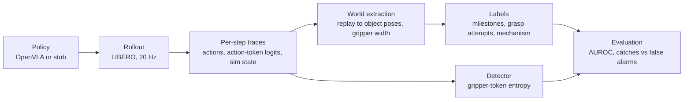

# OpenVLA failure analysis on LIBERO-Long

Can a robot policy's own uncertainty warn that a grasp is about to fail? This project tests that
for OpenVLA, a vision-language-action model, on LIBERO-Long, a benchmark of multi-step household
manipulation tasks in simulation.

**Gripper-token entropy did not reliably predict grasp failure.** Frozen on 250 episodes and
tested once on 250 held-out episodes, it scored a failed grasp attempt above a successful one 56%
of the time (95% CI 49% to 63%, AUROC; 110 failed and 237 successful first attempts), short of the
pre-registered bar. The signal it does carry is a few uncertain steps where the near-binary
gripper token flips, and those look the same before failures and successes.

The pass criterion was set before testing, and the held-out episodes were used once, so the result
could not be adjusted after the fact.


*Same task, same box: a grasp that fails (top) and one that succeeds (bottom), aligned on the
close command, at half speed. The detector scores the 30 steps before the close. Both spike to near
a coin flip inside that window, and both raise the alarm. In the failure, the trace stays at
"certain" while the box slips out.*

## What's here

- **A reproduced baseline.** `openvla/openvla-7b-finetuned-libero-10`, used as released with no
  further fine-tuning, succeeds on 130 of 250 episodes (52.0%, 95% CI 45.8% to 58.1%), in line
  with the 53.7 ± 1.3% the OpenVLA paper reports.
- **A failure taxonomy.** Each of the 120 failures is coded by how far the task got and what went
  wrong first, by hand or by a rule-based classifier over simulator state that agrees with held-out
  hand labels on 20 of 29 decided cases.
- **A pre-registered detector test.** The detector and its pass criterion were frozen before the
  held-out run; the result is recomputable from committed files with one command, no GPU needed.

This is an independent evaluation, not affiliated with the OpenVLA or LIBERO authors.

## Results

### Failure prediction

At each first close command on a goal object, the primary detector (v1) averages the gripper
token's exp(entropy) over the preceding 30 policy steps and alarms above the level that 20% of
successful development attempts exceed. Its inputs are policy outputs only; labels come from
simulator state. Pre-registered pass: the AUROC CI excludes 0.5 and the excess-over-chance CI
(catch rate minus false-alarm rate) excludes 0.

| | AUROC | caught | false alarms | excess over chance | pass |
|---|---|---|---|---|---|
| v1 (primary), development, in-sample | 0.62 | 28 of 88 | 53 of 266 (20%) | 0.12 | n/a |
| **v1 (primary), held-out** | **0.56 (0.49 to 0.63)** | 32 of 110 | 42 of 237 (18%) | 0.11 (0.02 to 0.21) | **no** |
| v2 (secondary), held-out | 0.57 (0.50 to 0.64) | 34 of 110 | 44 of 237 (19%) | 0.12 (0.03 to 0.22) | marginal |

Development: init states 0–24; held-out: init states 25–49, evaluated once with no refit. 95% CIs
bootstrap over episodes within (task, episode outcome). v2 adds roll-dimension entropy; its AUROC
lower bound is 0.501, so `detector_eval.json` marks it as passing, but the verdict rests on the
pre-registered primary.

- **The gripper action is effectively binary.** Its probability sits on two tokens: exp(H) is 1
  when certain and 2 at a coin flip, and is at most 2.01 on all but 8 of 203,788 logged gripper
  steps (maximum 2.32). Half of all attempts never leave 1: no step in the window is uncertain.
- **Alarms come from 1–5 uncertain steps at the switch,** nearly all within 12 steps of the close
  command. On 15 reviewed videos, caught failures and false alarms look the same, and the signal
  does not follow the failure mechanism.

Full writeup: `docs/detector_findings.md`. Results: `docs/results/heldout/detector/`.

### Baseline

130/250 = 52.0% success (Wilson 95% interval 45.8–58.1%), 10 tasks × 25 init states, seed 0; the
OpenVLA paper reports 53.7 ± 1.3% for this checkpoint. Details: `docs/results/baseline/`,
`docs/baseline_findings.md`.

### Failure taxonomy

Every one of the 120 failures carries a milestone (subgoals completed, `k`, computed from replayed
simulator state) and a mechanism (the earliest error never recovered from). Rules:
`docs/labeling_protocol.md`. Per-episode table:
`docs/results/baseline/labeling/failure_mechanisms.csv`.

| Mechanism | Failures | Hand-labeled | Classifier |
|---|---|---|---|
| `control: grasp` | 41 | 14 | 27 |
| `perception` | 38 | 22 | 16 |
| `control: place` | 22 | 12 | 10 |
| `control: transport` | 11 | 5 | 6 |
| `inaction` | 7 | 2 | 5 |
| no identifiable onset | 1 | 1 | 0 |

`grounding` and `external`: 0. Milestones: `k` = 0 for 52 failures, 1 for 60, 2 for 8.
`perception` means the arm was off target at the grasp.

**Classifier agreement.** A rule-based classifier over world state (no model outputs) labels the
64 failures without a hand label. Thirty held-out episodes were hand-labeled blind to it, then the
classifier was frozen and scored once: **agreement 20/29 decided (69%), 1/30 abstained**; onsets
within ±10 steps for 18/29. On the 20 development labels it agrees 20/20, optimistic by
construction. Four rules were revised after held-out labeling exposed them, so agreement on those
four episodes is not independent.

<details>
<summary>The 9 held-out cases that did not agree</summary>

Every disagreement sits on the boundary between neighbouring stages: aiming versus closing at the
grasp, or carrying versus placing.

| Hand label → classifier | n | Episodes | What happened |
|---|---|---|---|
| `perception` → `control: grasp` | 4 | t00-i003, t00-i010, t02-i006, t08-i001 | Two closed with high finger-pad cover on the object (0.67, 0.79), read as on target; in two the predicted onset is 19 and 42 steps later than the hand onset |
| `control: place` → `control: transport` | 3 | t04-i000, t04-i008, t05-i011 | The object shifted in the hand while carried; the classifier counts that as the first error |
| `control: transport` → `control: grasp` | 1 | t01-i024 | Onset placed at the grasp, 55 steps earlier |
| `control: grasp` → `perception` | 1 | t04-i019 | Low pad cover (0.16) at the close |
| `control: place` → abstain | 1 | t05-i019 | No unrecovered error found |

`control: place` is the weakest class: 1 of 4 decided. Per-episode detail:
`docs/results/baseline/labeling/mechanism_heldout_report.md`.

</details>

## How it works



Labels never see model outputs, and the detector's score uses policy outputs only; world state
decides only which close commands are scored and how they are labeled. Predicates and classifiers are pure functions over traces, unit-tested on
synthetic trajectories. The policy sits behind an interface, so a stub drives the full pipeline on
CPU.

## Reproduce

**The detector result, from committed files** (seconds; needs only `numpy` and `h5py`):

```bash
python scripts/run_detector.py metrics \
  --scores docs/results/heldout/detector/scores.csv \
  --frozen docs/results/baseline/detector/frozen_detector.json --out /tmp/detector
```

This reproduces `docs/results/heldout/detector/detector_eval.json` exactly.

**From the held-out traces** (raw traces are not in git): `bash scripts/detector_heldout_eval.sh
<run_dir>` extracts world state, labels attempts, scores and evaluates. `scripts/make_demo_clip.py`
renders the clip above from the same traces.

**From scratch** (GPU pods, about 8 GPU-hours on an RTX 4090 at ~417 policy steps per episode):
one command per pod, then one local merge.

```bash
python scripts/run_eval.py --policy openvla --tasks 0:10 --init-states 25:30 --seed 0  # per pod
python scripts/merge_runs.py <shard dirs> --out outputs/heldout --tasks 0:10 --init-states 25:50
bash scripts/detector_heldout_eval.sh outputs/heldout
```

A rerun may not match episode for episode: a second seed flipped 5 of 10 outcomes at matched init
states, and GPU numerics differ across GPU models. `--policy stub` runs the same pipeline on CPU.
The sharded run is described in `docs/pod_runbook.md`.

## Limitations

- **One seed.** The seed-to-seed noise floor is unmeasured and may be large relative to these
  effects.
- **No unseen init states remain.** LIBERO has 50 per task and both halves are used, so a revised
  detector cannot be tested on new initial conditions.
- **The in-sample 0.62 is optimistic by construction;** the window and features were chosen on the
  development set. Why it fell to 0.56 is not established.
- **The attempt boundary is the labeler's weak point.** One-step close commands can split or merge
  attempts; 1 of 15 reviewed held-out labels was wrong.
- **Scope.** Simulation only, one policy, one embodiment, one task suite.
- **No robustness study.** A planned robustness study (perturbations, cross-suite transfer) was
  not run: with the detector at chance-adjacent AUROC, there was no detector worth stress-testing.

## Repo layout

```
.
├── harness/              # rollout loop, trace schema, world extraction, labels, detector (pure)
├── scripts/              # eval runs, merges, labeling and detector pipelines, smoke tests
├── tests/                # unit tests on synthetic trajectories; `-m env` tests build LIBERO envs
├── docs/                 # findings, labeling protocol, setup guide, committed result summaries
├── provision.sh          # builds the env, sibling repos, and (on GPU) checkpoint — once per machine
├── setup_env.sh          # per-shell setup: rendering backend and env vars
├── requirements-lock.txt # exact pip versions of the verified env
├── constraints.txt       # pip constraints applied via PIP_CONSTRAINT
├── LICENSE
└── README.md
```

`openvla` and `LIBERO` are cloned as sibling directories of this repo, outside it — they're
external dependencies with their own git history, not vendored in. `provision.sh` pins
both to fixed commits.

The policy under evaluation is `openvla/openvla-7b-finetuned-libero-10` everywhere: smoke
tests, prefetch, and the eval harness all use the same checkpoint.

## Setup

| Level | What runs | Needs |
|---|---|---|
| 1 | Recompute the detector result from committed files | `pip install numpy==1.26.4 h5py` |
| 2 | The full harness with a stub policy: tests, LIBERO rollouts, labels, detector pipeline | Linux, conda; no GPU |
| 3 | Real OpenVLA inference | An NVIDIA GPU with ≥ 16 GB, pre-Blackwell |

Levels 2 and 3 share one path:

```bash
git clone https://github.com/deep-rj/openvla-libero-failure-analysis.git
cd openvla-libero-failure-analysis
bash provision.sh && source setup_env.sh && conda activate openvla
python -m pytest -m "not env"
```

`provision.sh` builds a pinned conda env from `requirements-lock.txt` and clones `openvla` and
`LIBERO` beside this repo at fixed commits; on a GPU it also fetches the checkpoint and
flash-attn. Requirements, what each script does, output archiving, the setup behind the reported
results, and fixes for known dependency breakages are in [`docs/setup.md`](docs/setup.md).
