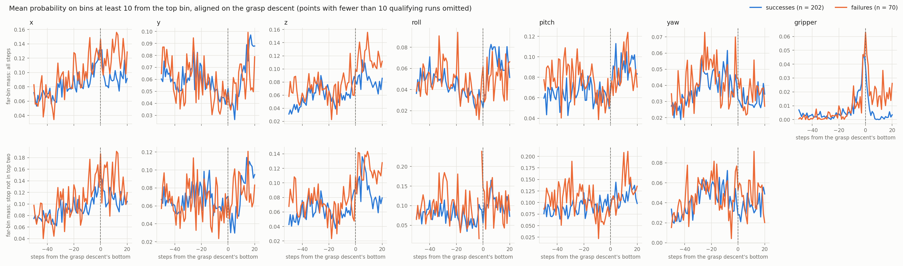

# Block 4: failure detector

Predict terminal failure from the policy's internal signals early enough to act (`PLAN.md`).
Started 2026-10-12, after the separability gate (`docs/separability_gate.md`) and before Block 3.

**Protocol.** Signals are explored on the baseline 250 episodes; every number from them is a
development number. The detector (features, window, thresholds, operating point) is frozen
before init states 25–49 are run, and is evaluated on them once.

## Design

- **Inputs: what a real robot has.** The policy's outputs (`slice_logits`, `lse_full`, emitted
  actions) and proprioception (`eef_pos`, `eef_quat_raw`, `gripper_qpos`). World state
  (`object_poses`, `fixture_joint_qpos`, `sim_state`) is for labels and evaluation only. Hidden
  states are not logged and are out of scope for this block.
- **When it speaks: at each close command.** The detector reads every step and emits a verdict
  when the policy's gripper action switches from open to close. The gate's anchors cannot run
  online (they use object poses and look back from the close), and the close command lands within
  one step of the anchor for 52 of 60 failures and 174 of 198 successes, so the gate's 50-step
  window carries over. Covers the 61 failures with a closing anchor, of 79: 9 open descents, 5 with
  no anchor, 4 fixture. Alerting at every step is parked.
- **Lead time is measured against the width baseline.** Not against onset: a grasp failure's onset
  is the bottom of its descent by protocol, so onset minus anchor is 0 (median). Not against a
  no-return point: none is labeled, since LIBERO failures end at the step cap.
- **An attempt runs from a close command at a goal object (within 15 cm, none held) until the
  fingers reopen**: width more than 5 mm above its narrowest since the command. At 2 mm, fingers
  spreading on an object that shifts in the grasp end the attempt before the hold registers (6
  success anchors labeled failed; 2 at 5 mm). Not until the next open command: 37% of close commands are
  followed by an open after one step, and the gripper target moves only 0.25 of its range per
  step (robosuite integrates the command's sign at 0.01 per substep, 25 substeps), so a one-step
  open barely moves the fingers.
- **Target: this attempt fails, whether or not the policy recovers later.** LIBERO failures are
  timeouts, so a failed attempt the policy recovers from still costs budget. An attempt succeeds
  if a hold on a goal object begins before the fingers reopen and does not end in a slip (the
  classifier's rule: the object leaves before the fingers open, and falls); otherwise it fails.
  Attempts whose fingers reopen before closing past 7 cm (the protocol's open width) are
  excluded as aborted. That exclusion drops 5 hand-labeled failures where aborting a good grasp
  was the error (`t01-i010`: reopened with the cream cheese between the fingers).
- **Width baseline: fires when the width falls below 3 mm within the attempt**
  (`harness/detector.py`). Tuned on the baseline 250, frozen with the detector and evaluated once
  on init states 25–49. 4 mm catches 2 more failures at the same false alarms but sits 0.1 mm
  below the narrowest successful bowl-rim grasp; 3 mm keeps 1.1 mm.
- **Target attempts: first attempts on each goal object**, failed or slipped (whether or not
  the episode recovers) against successful. Retries are predicted by the attempt count alone
  (AUROC 0.83), a consequence of the first failure rather than a forecast of it, so they are out
  of scope.
- **Features: v1 gripper exp(H) alone (primary); v2 adds stop-filtered roll exp(H)
  (secondary).** The only first-attempt signals (gripper 0.62; roll 0.63, nearly uncorrelated
  with it, r 0.13). v1 is a window mean; v2 is the mean of the two features' percentile ranks
  against successful development first attempts, so neither feature's scale dominates and
  nothing is fitted. Shape features (trend, peak, spread, last steps) were tried and dropped:
  correlated 0.78–0.89 with the mean, no gain in combination (0.59–0.61).
- **Windows: the best of a declared grid on the baseline 250**: gripper 30 steps, roll 100.
- **Alarm: above the threshold that lets 20% of successful development first attempts alarm.**
- **Metrics:** same-task AUROC; failures caught, false alarms and excess over chance (catch rate
  minus false-alarm rate: what a random alarm firing as often would not catch), with 95% CIs.
  The width baseline is context: every detector catch is earlier than width (median 18 steps on
  shared catches) since width fires only once the fingers have closed.
- **Success on init states 25–49:** for v1, the AUROC CI excludes 0.5 and the excess-over-chance
  CI excludes 0. v2 is reported the same way as a secondary result. With about 80–90 failed
  first attempts expected, a true AUROC of 0.62 is confirmed with roughly 60–80% probability.

## Frozen detector

`docs/results/baseline/block4/frozen_detector.json` (`scripts/block4_detector.py freeze`), from
88 failed and 266 successful development first attempts: v1 alarms above gripper exp(H) 1.0203,
v2 above a mean rank of 0.698. In-sample on development (`dev_eval/`): v1 catches 28 of 88 at
53 of 266 false alarms against 17.5 for a random alarm (AUROC 0.62); v2 catches 28 (AUROC 0.65).

Held-out run, init states 25–49 (250 episodes; about 500 pod-minutes, about $6 at
$0.025/episode, sharded as in `docs/block1_pod_checklist.md`):

```bash
python scripts/run_eval.py --policy openvla --tasks 0:10 --init-states 25:50 --out outputs/heldout
python scripts/merge_runs.py <shard>... --out outputs/heldout --tasks 0:10 --init-states 25:50
bash scripts/block4_heldout_eval.sh outputs/heldout
```

## Exploration log

Same anchors and units as the gate, after its anchor fix
(`docs/results/baseline/gate/anchors.csv`: 70 grasp and perception failures, 202 success grasps), same-task AUROC with failures above successes, and
99.17% bootstrap CIs over episodes.

### Far-bin mass (2026-10-12)

The probability a step puts on bins at least 10 from its top bin: a genuinely different action
(10 bins ≈ 3 mm per step on x). Window mean over the last 40, 50 and 75 pre-grasp steps, on all
steps and on steps where the no-motion bin is not in the top two (`scripts/gate_far_bins.py`,
`docs/results/baseline/block4/far_bins.md`). 2,000 draws; 39 tests, each with a beyond-exp(H)
version.

- It separates about as well as exp(H): x 0.63–0.64, pitch 0.64–0.67 (all steps); roll
  0.69–0.73, pitch 0.62–0.66, z 0.65 and y 0.62 at 75 steps, x 0.62 at 50 (stop not in the top
  two).
- Failures put more probability on a different action. Stop-filtered roll averages 0.106 in
  failures against 0.075 in successes over 75 steps; pitch 0.103 against 0.084.
- It tracks exp(H) closely (r 0.61–0.92 on motion dims, 0.99 on the gripper). After removing
  its linear dependence on window exp(H), no dim separates (0.43–0.61). At this n, far-apart
  doubt adds nothing measurable beyond entropy.



### Width baseline (2026-10-13)

An empty close read from finger width alone (`scripts/block4_width_baseline.py`,
`docs/results/baseline/block4/width_baseline.md`): at the close command nearest each closing
anchor, fire at the first step of the attempt whose width (`gripper_qpos` q0 − q1) is below the
threshold. 60 failures and 198 successes have a command within 10 steps of the anchor. On held
closes from open, width is flat into the command step and narrows from the next step, consistent
with step k's observation preceding action k.

- At 3 mm it fires on 27 of 60 failures and 2 of 198 successes, a median 16 steps (0.8 s sim)
  after the command; 20 of the 27 within 14–20 steps, the rest up to 56 as the fingers creep
  closed. Lower thresholds fire later and on fewer failures (1 mm: 13 of 60, 37 steps).
- Above 4 mm, successful thin grasps enter: bowl rims (narrowest 4.1 mm), the porcelain mug handle
  (5.7 mm). 6 mm fires on 25 successes.
- The two false alarms at every threshold from 1 to 4 mm: a butter grasp (`t01-i008`) whose
  fingers close empty, with the butter later sitting 15 cm above the end effector after a physics
  glitch, the episode counting as a success; and a mug (`t09-i017`) held by its handle at 19 mm
  for steps 104–146, after which the fingers close to 1 mm without reopening.
- 22 failures stay at 15 mm or wider and are invisible to width.
- Minimum width over the attempt has same-task AUROC 0.65 (99.17% CI 0.52 to 0.79), against
  0.62–0.63 for exp(H) in the gate. Bounding the attempt matters: over a fixed 60 steps, later
  re-closes are credited to the attempt and the AUROC is 0.76.
- Failures release the close quickly: the close command holds a median 5.5 steps in failures
  against 54.5 in successes. A post-hoc signal; not pursued.

### Attempt labels (2026-10-13)

Every attempt in the baseline 250 (`scripts/block4_attempts.py`,
`docs/results/baseline/block4/attempts.csv`), checked against the gate anchors through the attempt
nearest each closing anchor.

- Failure anchors (61): 46 failed, 9 slips, 5 aborted, 1 with no attempt, none successful.
  Success anchors (202): 192 successful, 4 slips, 2 failed, 4 with no attempt.
- Over all attempts: 973 failed and 27 slips against 471 successful; 178 aborted. Failed
  episodes hold 827 of the failed attempts, about 7.5 per failed episode with attempts.

### Attempt-level separability (2026-10-13)

The gate's exp(H) test with attempts as units (`scripts/block4_attempt_separability.py`,
`docs/results/baseline/block4/attempt_separability.md`): window mean over the 50 policy steps
before the close command, failed and slipped attempts against successful ones, bootstrap over
episodes within (task, episode outcome).

- The attempts nearest the gate anchors reproduce the gate: x 0.62, y 0.61, stop-filtered roll
  0.71.
- Over every attempt (1000 failed, 471 successful) z and pitch separate more than in the gate
  (z 0.68, 0.74 stop-filtered; pitch 0.64, 0.70), and the gripper reaches 0.68.
- At the first attempt per goal object per episode (88 failed, 266 successful) nothing but the
  gripper separates (0.61; motion dims 0.49–0.60).
- The attempt's index on its object, alone, has AUROC 0.83 (0.71 to 0.88): failed
  attempts are mostly retries. Within retries (912 failed, 205 successful) z and pitch still
  separate (stop-filtered z 0.70, pitch 0.68); the gripper does not (0.56). Within successful
  episodes, z is 0.73 (0.56 to 0.84).
- Not yet separated from retry history: a retry's 50-step window can include the previous
  attempt's lift and reopen.
- First attempts only, split by episode outcome (exploratory, 13 tests): failed first attempts in
  failed episodes (73) against successful first attempts (266) separate on no motion dim
  (0.48–0.60, every CI includes 0.5); the gripper is 0.62 (0.51 to 0.73). Failed first attempts
  in successful episodes number 15, too few to read. The gate's 0.62–0.63 at initiator anchors
  does not reappear on first attempts; the gate's success units include grasps after misses.

### Window sweep, first attempts (2026-10-13)

All failed and slipped first attempts (88) against successful ones (266)
(`scripts/block4_window_sweep.py`, `docs/results/baseline/block4/window_sweep.md`).

- Gripper exp(H) is flat from 10 to 50 steps (0.60–0.62) and peaks at 30 (0.62, 0.52 to 0.72):
  its signal sits in the last steps before the close. Frozen window: 30.
- Stop-filtered roll rises with length to 0.63 at 75–150 steps (0.63, 0.53 to 0.73 at 100). At
  100 steps 172 of 353 windows are cut by the episode start: first attempts come early, so long
  windows cover the approach from the start. Frozen window: 100.

