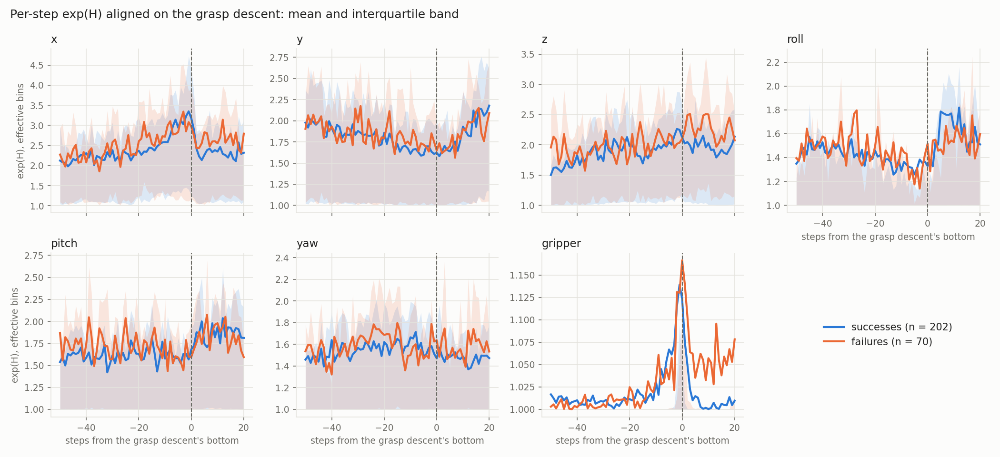
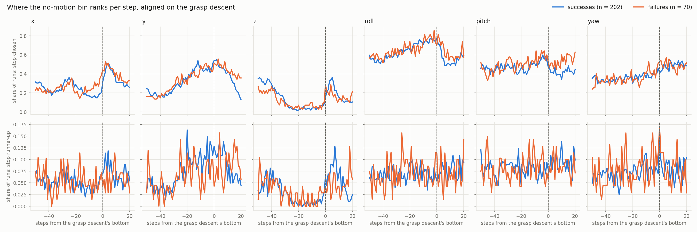
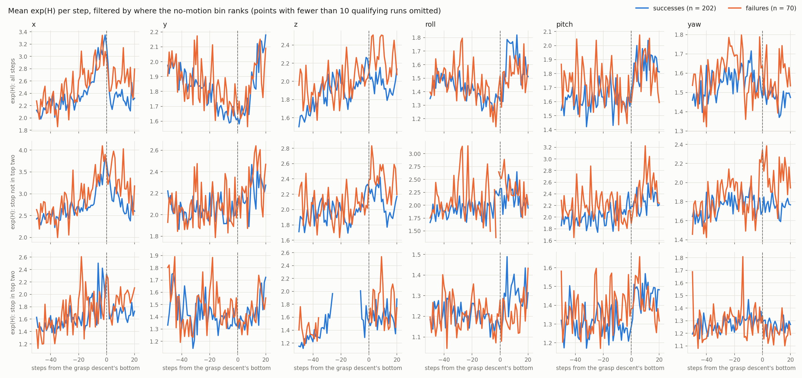
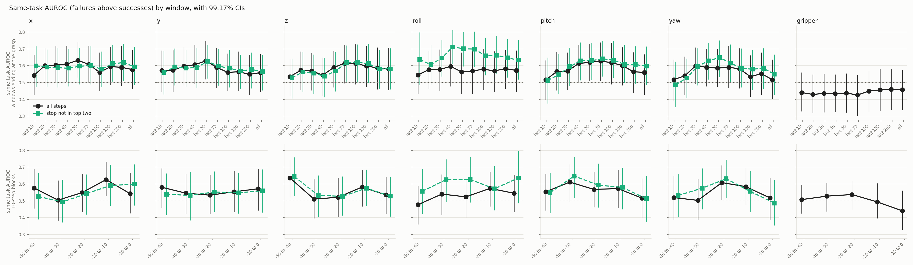

# Separability gate

The check before Block 4 (`PLAN.md`): does any internal signal of the policy differ between
failed and successful rollouts **before** the moment a grasp fails? If nothing does, the project
falls back to the descriptive study (taxonomy plus robustness sweep).

## Pre-registration (2026-10-12, before any outcome split)

**Units.**
- Failures: `perception` and `control: grasp` failures at objects
  (`failure_mechanisms.csv`). Fixture failures are excluded (no grasp descent):
  `t02-i007`, `t02-i008`, `t02-i014`, `t03-i008`.
- Successes: each place subgoal of each successful episode, i.e. one unit per object grasped.

**Anchor.** The bottom of a grasp descent at a goal object: the pad-midpoint low point before
a close, or of a descent that never closes (the classifier's onset rule).
- Failure: the descent nearest the labeled onset, within 60 steps. Pilot onsets predate the
  bottom-of-descent rule, so the labels only pick the attempt. A slip (a goal object held at
  the step before the onset) anchors on the grasp that began the slipped hold.
- Success: the closing descent that began the object's last hold.
- Failures with no descent found are excluded: `t00-i020`, `t00-i022`, `t00-i024`,
  `t01-i022`, `t05-i018`. One success unit has none: `t05-i010` (book).

**Window.** Up to 50 non-wait steps before the anchor (the anchor excluded); units with fewer
than 10 are dropped. None were (shortest 28).

**Metrics**, per unit, averaged over the window. exp(H) is over the 255-bin distribution
(`pilot_report.derive_step_metrics`).
- Primary: gripper (dim 6) mean exp(H).
- Exploratory: mean exp(H) of each motion dim 0–5, one test each.
- Secondary, reported only: gripper near-tie rate (bin margin ≤ 4 bf16 ulps).

**Test.** AUROC = P(failure value > success value), ties half. Same-task AUROC compares only
pairs within one (task, object) stratum and is decisive; pooled AUROC is reported beside it.
CIs come from a percentile bootstrap over episodes, resampled within (task, outcome), with
10,000 draws and seed 0. Levels: primary 95%; exploratory 1 − 0.05/6 = 99.17% each.

**Pass rule.**
- The gate passes if the primary or any exploratory same-task CI excludes 0.5, in either
  direction.
- **P1** (failures are less decided on the gripper before the grasp) is supported only if the
  primary same-task CI lies above 0.5.

**Curves** (descriptive, not tested): per-step exp(H) per dim, from −50 to +20 steps around the
anchor, as a mean and interquartile band per outcome.

## Changes to the 2026-10-06 predictions (`block1_findings.md`)

- **P1 amended.** It was a per-episode gripper near-tie count within 5 cm of the target. It
  becomes the windowed gripper exp(H) above. Reason: blind pooled counts showed 69% of windows
  with zero near-ties at ≤ 4 ulps (83% at ≤ 1, 43% at ≤ 16), so the AUROC would mostly compare
  zeros. The near-tie rate stays as the secondary.
- **P3 withdrawn** (rotation entropy does not separate). Covered by the per-dim exploratory
  tests.
- **P4 withdrawn** (gripper saturation does not separate). Covered by the primary.

## Seen before the freeze

- Pooled near-tie counts per window, both outcomes mixed (above).
- A dry run on labels shuffled within task. Null calibration over 40 shuffles: the 95% CI
  excluded 0.5 in 2/40 (gripper exp(H)), 2/40 (near-tie rate) and 3/40 (x exp(H)), against
  2/40 expected.

## Reproduce

```bash
python scripts/gate_anchors.py outputs/baseline \
    --mechanisms docs/results/baseline/labeling/failure_mechanisms.csv --out outputs/baseline/gate
python scripts/separability_gate.py outputs/baseline --out outputs/baseline/gate
```

## Result (2026-10-12, freeze `f117928`)

70 failures, 202 success grasps. Files: `docs/results/baseline/gate/` (`gate_report.md`,
`gate_results.json`, `anchors.csv`, `curves.png`).

| Metric | CI level | Same-task AUROC [CI] | Pooled AUROC [CI] |
|---|---|---|---|
| **gripper exp(H)** (primary) | 95% | 0.438 [0.350, 0.527] | 0.462 [0.388, 0.536] |
| x exp(H) | 99.17% | 0.632 [0.530, 0.738] | 0.536 [0.451, 0.625] |
| y exp(H) | 99.17% | 0.629 [0.520, 0.739] | 0.530 [0.435, 0.626] |
| z exp(H) | 99.17% | 0.589 [0.470, 0.703] | 0.581 [0.490, 0.669] |
| roll exp(H) | 99.17% | 0.563 [0.443, 0.679] | 0.530 [0.440, 0.623] |
| pitch exp(H) | 99.17% | 0.620 [0.511, 0.728] | 0.595 [0.508, 0.682] |
| yaw exp(H) | 99.17% | 0.586 [0.469, 0.699] | 0.534 [0.447, 0.617] |
| gripper near-tie rate (secondary) | 95% | 0.439 [0.371, 0.507] | 0.469 [0.414, 0.523] |

**Gate: pass** under the pre-registered rule: the same-task CIs of x, y and pitch exclude 0.5.
**P1: not supported**: the primary CI includes 0.5, and its point estimate is below it.



### Interpretation and decision (2026-10-12)

The gate passes, but the separation is weak. Three motion dims separate within task (AUROC
0.62–0.63, lower bounds 0.51–0.53); pooled across tasks only pitch does, and the interquartile
bands of failures and successes overlap almost entirely at every step. The gripper, the one
signal predicted in advance, shows no warning before the grasp.

The exploratory checks below do not strengthen the case for a pre-grasp warning. Arm speed does
not explain the difference, and it sits on steps where the policy weighs different motions
rather than motion against stopping (roll 0.70 on those steps). It grows with the window
length up to 40–75 steps and fades beyond, instead of peaking near the grasp, and no 10-step
block stands out. That reads as a
small, persistent offset over the approach rather than a warning that builds before the grasp.
All of this was found after looking at the data and is a lead, not evidence.

**Decision: go to Block 4, with modest expectations.** Block 4 tests whether combining dims,
longer context and the no-motion filter yields a usable detector. Signals are explored on the
baseline 250 episodes; the frozen detector is evaluated once on init states 25–49 (250 new
episodes, ~8.5 GPU-h).

## Exploratory, after the freeze: motion check (2026-10-12)

Does arm speed in the same window explain the motion-dim result? Speed is the end effector's,
from world state (`scripts/gate_motion_check.py`, `docs/results/baseline/gate/motion_check.md`).

- Speed does not separate: translation AUROC 0.433 [0.346, 0.526], rotation 0.577
  [0.485, 0.667] (same-task, 95%).
- Per-unit exp(H) correlates weakly with speed (|r| 0.13–0.28).
- With the linear speed effect removed, same-task AUROCs (99.17% CIs) barely move: x 0.624
  [0.518, 0.730], y 0.636 [0.526, 0.748], pitch 0.620 [0.510, 0.728]. Each still excludes 0.5.

## Exploratory, after the freeze: no-motion check (2026-10-12)

Per step and motion dim, the no-motion bin (raw action 0) is the top choice, the runner-up, or
neither (`scripts/gate_stop_check.py`, `docs/results/baseline/gate/stop_check.md`; plot
`stop_curves.png`, `stop_filtered_curves.png`). Same-task AUROC with 99.17% CIs; 24 tests.

- The share of window steps with stop chosen, or stop runner-up, separates on no dim. Stop is
  the runner-up in 0–17% of runs at any step.
- exp(H) on steps where stop is *not* in the top two separates on y 0.625 [0.530, 0.725],
  roll 0.701 [0.597, 0.800], pitch 0.630 [0.516, 0.741] and yaw 0.649 [0.540, 0.753].
- exp(H) on steps where stop *is* in the top two separates only on z: 0.654 [0.525, 0.769],
  on 53 failures and 177 success units with such steps.





## Exploratory, after the freeze: window sweep (2026-10-12)

Is 50 steps the right window? Same-task AUROC of mean exp(H) over the last 10, 20, 30, 40, 50,
75, 100, 150 and 200 steps before the anchor and over every step since the start, and over
disjoint 10-step blocks, on all steps and on steps with stop not in the top two
(`scripts/gate_window_sweep.py`, `docs/results/baseline/gate/window_sweep.md`). 2,000 bootstrap
draws, 99.17% CIs, 195 tests.

- The AUROC rises with window length to a peak at 40–75 steps (2–3.75 s), then falls. Over the
  last 10 steps no dim separates (0.49–0.64); over the whole episode before the anchor only
  stop-filtered roll does (0.63 [0.52, 0.75]), and the rest sit at 0.52–0.60.
- Stop-filtered roll is the most stable: 0.63–0.71 from 30 steps to the whole episode, peaking
  at 0.71 over the last 40.
- No 10-step block stands out consistently. 6 of 65 block CIs exclude 0.5, scattered across
  dims and blocks.
- The gripper is 0.43–0.44 for every cumulative window.
- Shorter windows average fewer steps, so their AUROCs are noisier and pulled toward 0.5 even
  if the per-step effect were constant. The rise with length alone does not show where the
  signal lives; the blocks bear on that.


